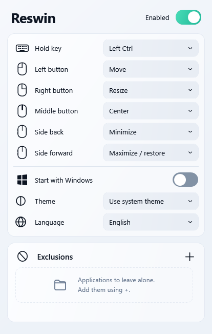
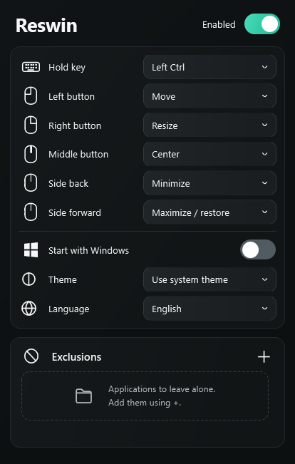

# Reswin

A small Windows utility that lets you move and resize windows from anywhere inside them. Hold a modifier key, then use your mouse.

[Download 1.0.0](https://github.com/adzh1ev/Reswin/releases/tag/v1.0.0) · [Русский](README.ru.md)

 

## Get started

1. Download `Reswin-portable.zip` from [Releases](https://github.com/adzh1ev/Reswin/releases/latest).
2. Extract it into a permanent folder and run `Reswin.exe`. No installation is needed.
3. Point at a window and hold **Left Ctrl**:

| Mouse button | Default action |
| --- | --- |
| Left, hold | Move the window |
| Right, hold | Resize from the nearest edge or corner |
| Middle, click | Center on the current monitor |
| Back side button | Minimize |
| Forward side button | Maximize; click again to restore |

Release the button or modifier to end a drag. Centering respects the monitor's work area, including the taskbar.

## Settings

- Choose **Left Ctrl** or **Left Alt** and assign each of the five buttons independently.
- Add running applications to **Exclusions** using **+**. All windows of that executable will be ignored. Remove an entry with **×**.
- Choose a light, dark or system theme, and Russian or English.
- Enable **Start with Windows** to launch in the tray when you sign in. It stays off until you turn it on.

Settings save immediately to `%LOCALAPPDATA%\Reswin\settings.xml`. Exclusions use the executable's full path; add an application again if that path changes.

Closing or minimizing settings hides the window in the system tray. Double-click the tray icon to reopen it. Use the tray menu to pause or exit. A second launch opens the existing instance.

`Reswin.exe --tray` starts directly in the tray. If you move the executable after enabling startup, turn startup on again from the new location.

## Requirements and limitations

Windows 10/11 x64 with .NET Framework 4.8 and WPF. The application uses C#, WPF and Windows APIs, without third-party packages, a browser engine or network requests.

Moving a maximized window restores it first. Resize and center actions skip maximized windows. Fixed-size windows cannot be resized. Desktop, taskbar, hidden and some full-screen windows are ignored.

To control an application running as administrator, Reswin needs the same privilege level. Applications with custom frames, games and shared host processes may behave differently. Mixed-DPI multi-monitor setups still need hardware-specific validation.

## Source

| Files | Purpose |
| --- | --- |
| `src/WindowEngine.cs`, `src/Native.cs` | Input hooks and window operations |
| `src/MainWindow.cs`, `src/Interface.cs` | Settings and application picker |
| `src/Theme.cs`, `src/Interaction.cs`, `src/SmoothScrollViewer.cs` | Styling, motion and scrolling |
| `src/Settings.cs`, `src/Localization.cs`, `src/Startup.cs` | Persistence, languages and opt-in startup |
| `src/Program.cs`, `src/Icons.cs` | Application lifecycle, tray and icons |
| `src/TestSuite.cs`, `src/UiChecks.cs` | Window and interface checks |
